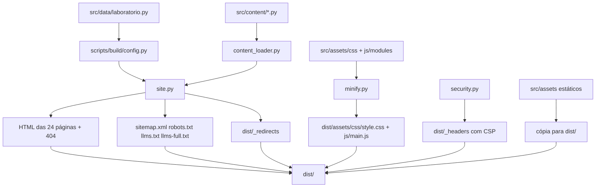

# Arquitetura do site — Laboratório Dental Araújo

Atualizado em 26/10/2026. Site: https://brilliant-cat-c5b6e9.netlify.app
(gerado por `python -m scripts.build` → `dist/`). Uso diário: ver o [README](../README.md).

## 1. Visão geral

| Camada | O que é | Onde |
|---|---|---|
| Dados do laboratório | Nome, CNPJ, endereço, telefones, WhatsApp, e-mail, horários, redes | `src/data/laboratorio.py` (fonte única) |
| Conteúdo | Textos, FAQ, itens de serviço, condições, artigos, documentos legais | `src/content/*.py` |
| Templates | Layouts/partials (hoje reexportam o site; novos layouts entram aqui) | `src/templates/` |
| Estilo | CSS em módulos (tokens, base, layout, components, pages) | `src/assets/css/*.css` |
| Comportamento | JS em módulos concatenados no build | `src/assets/js/modules/*.js` |
| Build | Gerador modular Python | `scripts/build/` |
| Saída | HTML estático + assets + arquivos técnicos | `dist/` |
| Hospedagem | Netlify (CDN, HTTPS, URLs limpas, `_headers`, `_redirects`) | site `brilliant-cat-c5b6e9` |

Não há servidor, banco de dados, formulário, cookie nem script de terceiros. O único conteúdo
externo é o mapa do Google, que só é carregado quando o visitante clica em "Carregar mapa" (contato).

## 2. Árvore de pastas (comentada)

```
Laboratorio-Araujo/
├── README.md
├── docs/                          documentação (este arquivo, SEGURANCA, QUALIDADE, FOTOS…)
├── src/                           FONTE do site (é aqui que se edita)
│   ├── data/
│   │   └── laboratorio.py         fonte única: NAP, CNPJ, horários, redes, WhatsApp
│   ├── content/                   conteúdo editorial em Python
│   │   ├── catalogo.py            itens de cada linha (sem preços) + CONDICOES
│   │   ├── servicos.py            8 páginas de serviço
│   │   ├── blog.py                artigos do blog
│   │   ├── fotos_reais.py         catálogo das fotos reais (alt, legenda, recorte, uso)
│   │   ├── paginas.py             ficha técnica + FAQ da página de perguntas
│   │   ├── legal.py               privacidade (LGPD) e termos
│   │   └── resumos.py             "Pontos principais" e rótulos curtos da home
│   ├── templates/
│   │   ├── layouts/               page.py (reexporta header/footer/page do build)
│   │   ├── partials/              (reservado para blocos reutilizáveis)
│   │   └── pages/                 (reservado para páginas tipadas)
│   ├── assets/                    copiado/montado para dist/
│   │   ├── css/                   tokens, base, buttons, layout-*, components, pages-*, motion
│   │   │   └── bundle.txt         ordem de concatenação (= cascata do style.css legado)
│   │   ├── js/modules/            00-helpers … 12-galeria (+ bundle.txt)
│   │   ├── fonts/  icons/  img/   marca, og, foto, real/
│   │   ├── docs/                  PDF do modelo de requisição (único PDF publicado)
│   │   ├── favicon.ico
│   │   └── site.webmanifest
│   ├── private/marca/             PNG matriz do logo (não publicado; usado por tools/og.py)
│   └── fotos_reais.json           manifesto gerado por tools/foto_real.py
├── scripts/
│   └── build/                     gerador modular
│       ├── __main__.py            entrada: python -m scripts.build
│       ├── config.py              caminhos, BASE, TODAY, atalhos a partir de LAB
│       ├── content_loader.py      importa src/content/*
│       ├── util.py                escape, wa(), strip, ver (hash), nobreak, telclass, lc
│       ├── minify.py              concatena e minifica CSS/JS
│       ├── security.py            INLINE_JS, hash CSP, headers_file()
│       └── site.py                imagens, layouts, blocos, páginas, SEO/JSON-LD, meta, main()
├── tools/                         QA, fotos, OG, PDF de requisição, servidor local
├── dist/                          SAÍDA (não versionada; é o que sobe no Netlify)
├── private/arquivo/               tabela de preços original (local; NUNCA no Git público)
├── package.json                   scripts: build, serve, qa, qa:live, lint:*
├── requirements.txt               Pillow (build)
├── requirements-dev.txt           numpy, playwright, pypdf (QA/fotos)
└── netlify.toml                   command = python -m scripts.build; publish = dist
```

Convenções de nome: **kebab-case** nos arquivos web (CSS, JS, imagens, URLs);
**snake_case** no Python.

## 3. Fluxo de build



Comando: `npm run build` ou `python -m scripts.build` (≈ 1 s).

### Papel de cada módulo do build

| Módulo | Responsabilidade |
|---|---|
| `config.py` | `ROOT`/`SRC`/`DIST`/`ASSETS`, `BASE`, `TODAY`, `MODIFICADO`, atalhos (`WA`, `ADDR`, telefones) derivados de `LAB`, listas `CSS_BUNDLE`/`JS_BUNDLE` |
| `content_loader.py` | Único ponto que importa `src/content/*` e reexporta para `site.py` |
| `util.py` | `e` (escape), `wa`, `strip`, `ver` (hash de cache), `nobreak`, `telclass`, `lc` |
| `minify.py` | `assemble_css`/`assemble_js`, minificação conservadora, cópia de assets |
| `security.py` | Script inline `js`, hash SHA-256, string `CSP`, conteúdo de `_headers` |
| `site.py` | Imagens (`img`/`picture`), `header`/`footer`/`page`, blocos, JSON-LD, builders de página, `build_meta`, `main` |

Telefones, endereço e horários **só** saem de `src/data/laboratorio.py`. O `config.py` expõe
atalhos de formatação; o HTML e o JSON-LD leem esses atalhos (ou `LAB` direto).

## 4. Mapa de páginas

```
/                                        Home (prioridade 1.0)
├── /servicos/                           Hub de serviços (0.9)
│   ├── /servicos/protese-sobre-implante/
│   ├── /servicos/zirconia-e-max/
│   ├── /servicos/metaloceramica/
│   ├── /servicos/protese-parcial-removivel-ppr/
│   ├── /servicos/protese-total/
│   ├── /servicos/protese-flexivel-flexite/
│   ├── /servicos/resinas-e-provisorios/
│   └── /servicos/placas-de-bruxismo-e-ortodontia/        (8 páginas de serviço, 0.9)
├── /sobre/                              História, estrutura, condições de trabalho (0.7)
├── /trabalhos/                          Galeria de fotos reais por categoria, com ampliação (0.6)
├── /envio-para-todo-brasil/             Coleta em MG, envio de outros estados (0.7)
├── /perguntas-frequentes/               5 grupos de perguntas (0.7)
├── /contato/                            Endereço, telefones, mapa sob demanda, #orcamento (0.8)
├── /blog/                               Índice do blog (0.6)
│   ├── /blog/metaloceramica-ou-zirconia/
│   ├── /blog/ppr-ou-protese-flexivel/
│   ├── /blog/requisicao-para-laboratorio-de-protese/  (com PDF /assets/docs/requisicao-laboratorio-de-protese.pdf)
│   ├── /blog/zirconia-ou-e-max-qual-indicar/
│   ├── /blog/como-enviar-um-caso-para-o-laboratorio-de-protese/
│   └── /blog/barra-de-protocolo-etapas-e-prazos/
├── /politica-de-privacidade/            Política de privacidade, LGPD (0.3)
├── /termos-de-uso/                      Termos de uso (0.3)
└── /mapa-do-site/                       Índice HTML de todas as páginas (0.3). O arquivo técnico continua em /sitemap.xml
/404.html                                Página de erro (noindex, fora do sitemap)

Redirecionamentos (dist/_redirects): /tabela-de-precos/ → /contato/ (301). Página removida em 24/10/2026.
```

## 5. Convenções de URL

- Minúsculas, sem acento, palavras separadas por hífen, **sempre com barra no final**
  (`/servicos/protese-total/`). O Netlify serve `pasta/index.html` nessa URL.
- Dois níveis no máximo: `/<seção>/<página>/`. Serviços em `/servicos/`, artigos em `/blog/`.
- O slug contém a palavra-chave principal da página (`protese-parcial-removivel-ppr`).
- Âncoras úteis: `/contato/#orcamento`, `#itens` nas páginas de serviço, e uma âncora por seção
  nos documentos legais.
- CSS e JS publicados com `?v=<hash>` (cache de 1 ano; o hash muda a cada alteração).
- Variantes resolvem num único 301 para a URL canônica (Netlify + regras de `redirects_index()`).
- **Não mude URLs publicadas.** Se for inevitável, acrescente um 301 na constante `REDIRECTS`
  de `scripts/build/site.py` (gravada em `dist/_redirects`).

## 6. Front-end

- **CSS** (`src/assets/css/`): `tokens.css` (`:root`), `base`, `buttons`, `layout-chrome`,
  `layout-sections`, `pages-home`, `components`, `pages-internal`, `motion`, `layout-responsive`.
  A ordem em `CSS_BUNDLE` / `bundle.txt` preserva a cascata do `style.css` legado. O build gera
  um único `dist/assets/css/style.css` minificado.
- **JS** (`src/assets/js/modules/`): 00 helpers → 12 galeria. Cada módulo só roda se o elemento
  existir. Sem JS o site funciona (números finais, faixa com rolagem, timeline cheia).
- **Movimento**: revelações, contadores, faixa, timeline, microinterações e acordeões; respeita
  `prefers-reduced-motion`.
- **Páginas longas**: "Pontos principais" + acordeões `<details class="acc">` com o `<h2>` no
  `<summary>` (texto completo permanece no HTML).

## 7. Estratégia de SEO e GEO

**On-page:** title ≤ 60, description única, um H1, canonical, OG/Twitter, geo BR-MG, breadcrumbs +
`BreadcrumbList`, imagens com `alt` e dimensões, CSS/JS próprios.

**GEO:** `/llms.txt` e `/llms-full.txt`, ficha técnica citável, perguntas como H2, `robots.txt`
liberando bots de IA, `sitemap.xml` com `lastmod` e prioridade, NAP idêntico no site e no JSON-LD.

Mapa de palavras-chave completo: [PALAVRAS-CHAVE.md](PALAVRAS-CHAVE.md). Campos `primary`/`secondary`
em `src/content/servicos.py` e `blog.py`.

## 8. Dados estruturados (JSON-LD)

Cada página tem **um** `<script type="application/ld+json">` com `@graph`. Nós comuns:
`LocalBusiness + MedicalBusiness` (`@id` = `BASE/#laboratorio`) e `WebSite`. Demais nós conforme
o tipo (Service sem preço, FAQPage, Article, etc.). Nenhum nó tem `Offer`, `price` ou `priceRange`.

O nó do laboratório lê nome, CNPJ, endereço, geo, horários, telefones e redes de `LAB`.

## 9. Orçamento: o site não publica preços

Desde 24/10/2026 todos os serviços são **sob orçamento**. Controle:
`tools/qa_sem_precos.py` (no `npm run qa`) falha se `dist/` tiver "R$", "preço", "tabela-de-precos",
PDF indevido ou `Offer`/`price` no JSON-LD. A fonte original da tabela fica só em
`private/arquivo/` (local, fora do Git).

## 10. Documentos legais

Conteúdo em `src/content/legal.py`. São modelos: precisam de revisão do laboratório e de um
advogado. Pontos em aberto (DPO, retenção, papel no tratamento de dados de pacientes, etc.)
permanecem os da auditoria de 26/10/2026.

## 11. Passo a passo: adicionar conteúdo

### Serviço novo

1. Em `src/content/servicos.py`, copie um item de `SERVICOS` (`slug`, `nav`, `title`, `desc`,
   `kicker`, `h1`, `lead`, `img`/`img_alt`, `fig`/`fig_alt`, `primary`/`secondary`, `cats`,
   `service_type`, `blurb`, `body`, `faq`, `related`).
2. Se tiver itens próprios, crie a linha em `src/content/catalogo.py` e o ícone em `site.py` (`ICON`).
3. Rode `npm run build`. A página entra no menu, hub, sitemap e JSON-LD `Service` (sem preço).

### Artigo novo

1. Em `src/content/blog.py`, copie um item de `POSTS` (`slug`, `date`, `title` ≤ 60, `desc`,
   `h1`, `lead`, `img`/`img_alt`, `primary`/`secondary`, `related_service`, `related_posts`,
   `refs`, `body`).
2. Use `<h2>` nas seções e linke para o serviço comercial do mesmo assunto.
3. Rode o build. Entra no índice, sitemap, `llms.txt` e JSON-LD `Article`.

### Foto real nova

1. Acrescente o item em `src/content/fotos_reais.py` (e em `USO` se for topo/figura/faixa).
2. Exporte: `FOTOS_DRIVE=… FOTOS_CHAT=… python tools/foto_real.py` e, se precisar de capa,
   `python tools/og.py`.
3. Use `'real/<slug>'` no `img`/`fig` do serviço ou artigo. Rode o build.
4. Critérios e mapa: [FOTOS.md](FOTOS.md).

### Página institucional nova

1. Crie o builder em `scripts/build/site.py` (ou, no futuro, em `src/templates/pages/`).
2. Chame `out('/caminho/', html, prio)` em `main()`.
3. Se precisar de redirect, acrescente em `REDIRECTS`. Rode o build e `npm run qa`.

### Alterar telefone, endereço ou horário

Edite **somente** `src/data/laboratorio.py` e rode o build. Header, footer, contato, JSON-LD,
`llms.txt` e páginas legais/FAQ que citam o NAP passam a usar o valor novo.

## 12. Segurança e crédito

- CSP estrita em `scripts/build/security.py` → `dist/_headers`. Se o script inline mudar,
  o hash é recalculado no build.
- Crédito "Desenvolvido por [gandra.tech](https://www.gandra.tech/)" no rodapé (`footer()`).
- Logo azul em `src/assets/img/marca/logo-lda.webp` (e variante branca).
- Repositório público: nunca versionar `private/arquivo/`, `screenshots/`, tokens, `.env`,
  nem a tabela de preços.

## 13. Pendências do dono (fora do site)

0. Responsável técnico e CRO (Lei 6.710/1979).
1. Google Business Profile.
2. Domínio próprio (trocar `BASE` em `scripts/build/config.py`).
3. Google Search Console e Bing Webmaster Tools.
4. Avaliações no Google.
)
