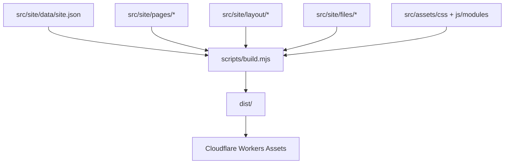

# Arquitetura do site — Laboratório Dental Araújo

Atualizado em 26/10/2026. A hospedagem primária é Cloudflare Workers Assets, configurada em
`wrangler.jsonc`. O domínio canônico é informado por `SITE_BASE`. O projeto é um site estático:
não há backend, banco de dados, API, formulário de aplicação ou servidor de aplicação.

## 1. Visão geral

| Responsabilidade | Fonte | Saída |
|---|---|---|
| Identidade e contatos repetidos | `src/site/data/site.json` | tokens resolvidos no HTML e nos arquivos técnicos |
| Conteúdo e metadados de cada rota | `src/site/pages/<rota>/index/{head,main}.html` | HTML estático em `dist/` |
| Shell compartilhado | `src/site/layout/before-main.html` e `after-main.html` | header, footer e scripts comuns |
| Arquivos técnicos | `src/site/files/` | `_headers`, `_redirects`, sitemap, robots e `llms*.txt` |
| Estilo | `src/assets/css/*.css` | `dist/assets/css/style.css` |
| Comportamento | `src/assets/js/modules/*.js` | `dist/assets/js/main.js` |
| Build | `scripts/build.mjs` | árvore publicável em `dist/` |
| Hospedagem | `wrangler.jsonc` | Cloudflare Workers Assets |

O mapa do Google é carregado somente após a ação do visitante na página de contato. Não há
processamento de dados no servidor do projeto.

## 2. Estrutura relevante

```text
Laboratorio-Araujo/
├── docs/                       documentação técnica
├── src/
│   ├── site/                   fonte estática publicada
│   │   ├── data/site.json      identidade e contatos tokenizados
│   │   ├── layout/             shell compartilhado fora do <main>
│   │   ├── pages/              head.html + main.html por rota
│   │   └── files/              headers, redirects, sitemap, robots e llms
│   ├── assets/                 CSS, JS, fontes, ícones e imagens
│   └── private/                arquivos locais não publicados
├── scripts/build.mjs           build Node.js/ESM
├── tools/
│   ├── serve.mjs               servidor local somente para arquivos estáticos
│   ├── lint-js.mjs             lint do bundle JS sem gerar arquivo-fonte
│   ├── qa-static.mjs           QA estrutural local
│   ├── qa-live.mjs             smoke test read-only do endereço publicado
│   ├── prepare-images.mjs      variantes de imagem sem Python
│   └── migrate-static-site.mjs ferramenta pontual de migração/recaptura
├── dist/                       saída gerada e publicada
├── package.json                scripts npm, lint, QA e Wrangler
└── wrangler.jsonc              configuração Cloudflare Assets
```

A fonte única de publicação e validação é Node.js. Não há runtime de backend ou dependência de
outra linguagem no repositório.

Convenções: URLs, CSS, JS e imagens usam kebab-case; cada rota publicada usa uma pasta `index/`
com `head.html` e `main.html`. O shell não deve ser duplicado nas páginas.

## 3. Fluxo de build



`npm run build` executa o fluxo completo:

1. remove e recria a saída `dist/`;
2. copia fontes, imagens, fontes, ícones e manifest;
3. concatena e minifica CSS/JS na ordem existente;
4. monta cada rota com o shell compartilhado e injeta `<main id="conteudo">`;
5. resolve os tokens de `site.json`;
6. atualiza as versões hash de `style.css` e `main.js`;
7. copia sitemap, robots, headers, redirects e arquivos `llms`.

O build não abre portas nem conecta banco. `npm run migrate:static` é
uma ferramenta pontual para criar/recapturar a fonte `src/site` a partir de um `dist` já validado;
não deve ser usada como parte do fluxo normal de edição.

`npm run images:prepare` é uma ferramenta opcional de desenvolvimento e requer ImageMagick no
PATH. O build e o deploy não dependem dela.

## 4. Limites arquiteturais

- `src/site/pages` contém apresentação, conteúdo e contratos SEO da rota.
- `src/site/layout` contém somente o shell comum, reduzindo duplicação entre 26 documentos HTML.
- `src/site/data/site.json` é a única fonte dos contatos que aparecem repetidos em várias páginas.
- `src/assets` contém apenas recursos de apresentação e comportamento no navegador.
- `dist` é derivado e não deve ser editado manualmente.
- Não existe camada de domínio, persistência ou serviço de aplicação porque o produto atual não
  possui comportamento de backend que justifique essas camadas.

Essa organização é deliberadamente estática. Ela não introduz Clean Architecture, framework de
frontend ou microserviço sem necessidade demonstrada.

## 5. Rotas e compatibilidade

As rotas publicadas são minúsculas, usam hífen e terminam com barra. O Wrangler está configurado
com `force-trailing-slash`. Não renomeie uma rota publicada sem inserir primeiro um redirect em
`src/site/files/_redirects`.

O build atual preserva 509 arquivos gerados no baseline validado: 25 páginas, 404, assets e
arquivos técnicos. A única diferença intencional em relação ao baseline original é o texto da
política de privacidade, que agora aponta o provedor de hospedagem Cloudflare.

## 6. Conteúdo e manutenção

### Alterar contato

Edite os valores correspondentes em `src/site/data/site.json` e execute `npm run build`. O build
substitui tokens de telefone, WhatsApp, e-mail, CNPJ e razão social nas rotas e arquivos técnicos.

### Alterar uma página

Edite o `main.html` da rota e, quando necessário, o `head.html` para title, description,
canonical, Open Graph e JSON-LD. Preserve o shell comum, a URL publicada, a ausência de preços e
os links internos existentes.

### Adicionar uma página

Crie `src/site/pages/<seção>/<slug>/index/` com `head.html` e `main.html`, atualize o índice,
`sitemap.xml` e os arquivos `llms*.txt`, e execute `npm run build` seguido dos gates de QA.

### Recursos visuais

CSS e JS continuam nos módulos existentes de `src/assets`. A migração do build não alterou a
cascata, os tokens visuais, as imagens, a estrutura de componentes ou as interações existentes.

## 7. Publicação

```powershell
$env:SITE_BASE = 'https://www.seudominio.com.br'
npm run build
npx wrangler deploy --dry-run
```

O dry-run valida a leitura da saída pelo Wrangler sem publicar. O deploy real só deve ser feito
com autorização explícita e após o domínio Cloudflare estar configurado.

## 8. Pendências conhecidas

- O domínio Cloudflare oficial deve ser informado em `SITE_BASE` antes de qualquer build ou deploy.
- A documentação legal continua sendo modelo e precisa de revisão do laboratório e de advogado.
